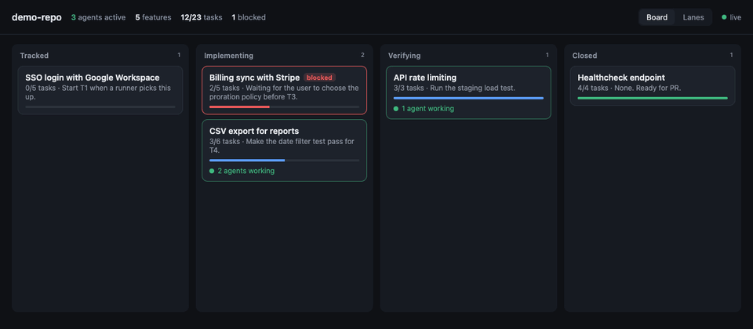
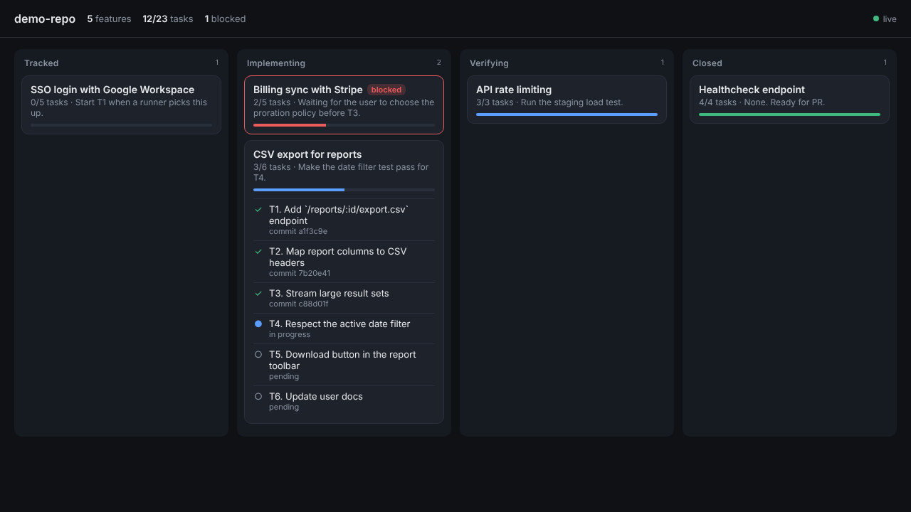
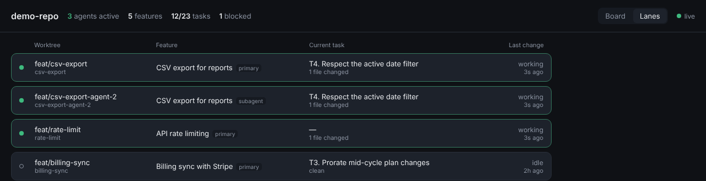

<!-- markdownlint-disable-next-line MD041 -->
<a id="top"></a>

<div align="center">

<h1>odd-board</h1>

<p><strong>A live Kanban board for ODD feature documents, with parallel agents made visible.</strong></p>

<p>
<a href="https://www.npmjs.com/package/odd-board"></a>
<a href="https://github.com/claudiocebpaz/odd-board/actions/workflows/ci.yml"></a>


<a href="LICENSE"></a>
</p>

<p>
<a href="https://claudiocebpaz.github.io/odd-board/"><strong>Website</strong></a> &bull;
<a href="#quickstart"><strong>Quickstart</strong></a> &bull;
<a href="#features"><strong>Features</strong></a> &bull;
<a href="#usage"><strong>Usage</strong></a> &bull;
<a href="docs/roadmap.md"><strong>Roadmap</strong></a> &bull;
<a href="CONTRIBUTING.md"><strong>Contributing</strong></a>
</p>

<sub>⚠️ Unofficial community project, not affiliated with or endorsed by <a href="https://github.com/Gentleman-Programming/gentle-ai">Gentle AI</a>. Report odd-board problems here, not to gentle-ai.</sub>

<p>
ODD keeps one feature document per feature, and your agents keep it current while they work.
But there is no way to see all of those documents at once, or which agents are running in parallel right now.
<strong>odd-board turns them into a board that moves on its own.</strong>
</p>



<br/>

<sub><strong>WORKS WITH ANY HARNESS THAT RUNS ODD</strong></sub>

<strong>Claude Code</strong> · <strong>OpenCode</strong> · <strong>Codex</strong> · <strong>Pi</strong> · and others

<sub>read-only · no backend · no database · no account · nothing to install</sub>

</div>

## Quickstart

```bash
npx odd-board            # in a repository that uses ODD
npx odd-board --demo     # temporary repo with simulated agents working in parallel
```

Add `--open` to open the board in your browser. The full list of options is in [Usage](#usage).

<div align="right"><a href="#top">Back to top</a></div>

## Features

---

### Columns from ODD stages — Never stored, always derived



ODD tracks substantial work in one feature document per feature (`odd/tasks/<feature>.md`) with objective, scope, a task checklist, evidence, progress and the next step. odd-board watches that folder and pushes every change to the browser over Server-Sent Events. Columns are derived from each document every time it changes, following the ODD stages that leave a trace on disk:

| Column | ODD stage | Rule |
| --- | --- | --- |
| Tracked | Track | Document exists, no task done yet |
| Implementing | Implement | Some tasks done, some open |
| Verifying | Close (in progress) | All tasks done, but checks or review still pending |
| Closed | Close | All tasks done, no pending checks |

**Blocked** is a flag, not a column: the card stays in the stage where it stalled and is outlined in red.

Authorize, Explore, Resolve uncertainty and Classify happen inside the agent session and never reach the file system, so they are not columns. Small work never gets a feature document, so it never shows up. That is ODD working as designed.

---

### Parallel agents — Read from git, never guessed



ODD records nothing about parallelism, so odd-board reads it from git, which knows it for certain:

1. `git worktree list` finds every checkout of the repository.
2. Each worktree is linked to a feature by its branch name. `feat/csv-export` is the feature's **primary** worker; `feat/csv-export-agent-2` (or any worktree nested inside the feature's worktree) is a **subagent** of the same feature.
3. A worktree is **active** when it changed in the last 10 minutes (uncommitted files or a recent commit). Change the window with `--window <minutes>`.

A card with active workers shows a pulsing "N agents working" line and lists its workers when expanded. The header counts active agents across the whole repository. A card in Implementing with no active worker is in progress but stalled. The **Lanes** view shows one row per worktree: branch, feature, current task, changed files and last activity. It is the quickest way to see what is running in parallel tonight.

The feature document is read from the feature's own branch when that worktree exists, then from the main checkout. File modification time alone is not trusted, because a worktree created later holds an older copy with a newer timestamp.

---

### Deterministic where it can be — Honest where it cannot

ODD does not define a status field or a fixed document schema. So:

- **Deterministic:** task counts and progress come from the state each task records. ODD only marks a task done with observed proof. Real gentle-ai documents record it in several ways, all supported:
  - checkboxes: `- [ ]` / `- [x]`, anywhere in the document;
  - inside a tasks section (`## Tasks`, `## Tareas`, `## Work units`): a table with a `Status` column, `- T1 | S1-S3 | ... | done | commit: <sha>` items, `1. [done] ...` items, and `- T1 — ...; inline; done, commit <sha>` items.

  Status words are read in English and Spanish (`done`, `complete`, `committed`, `hecho` · `pending`, `in progress`, `later`, `pendiente` · `blocked`, `bloqueado`). `dropped` or `superseded` tasks stay on the card but count neither as done nor as remaining. Indented items under a task (acceptance criteria, evidence) and anything inside code blocks are not tasks.
- **Commits:** a task's commit is a hash next to `evidence`/`commit`, in backticks, or in a `Commit` column. A bare hash must mix letters and digits, so numbers in the task text are not taken for commits, and hex IDs glued to a prefix (`review-562ea3fd…`, `sha256:…`) are not either.
- **Next step:** a `## Next step` section, else the last `Next:` / `Next step:` / `Próximo paso:` line.
- **Heuristic:** "blocked" and "pending checks" are detected from wording in the Progress, Next step and Evidence sections and top-level `Progress:` lines (English and Spanish). An open task marked blocked also flags the card. Negations ("no longer blocked"), something else being blocked ("a blocked request"), waiting on CI, test summaries with zero failures ("42 passed, 0 failed"), the RED step of test-first work, and failures the document calls pre-existing, unrelated or flaky are ignored. Wording cannot tell an old failure from a current one; see the known misses in `test/fixtures/gentle-ai-v4.3.1/README.md`.
- **Optional override:** if a document has frontmatter with `status: planned | in-progress | verifying | blocked | done`, it wins. This is a convention on top of ODD, not part of it.

Documents odd-board cannot understand are shown as `unparsed`. They are never dropped and never break the board.

---

### Zero dependencies — Read-only by design

odd-board has **zero runtime dependencies**: `package.json` has no `dependencies` and no `devDependencies`, and there is no build step. The whole package is a CLI, a few modules and a single HTML page. The server listens on `127.0.0.1:4747` by default, only reads files and never writes to your `odd/` folder. No database, no account, no API key, no network access.

<div align="right"><a href="#top">Back to top</a></div>

## Install

odd-board is published on npm as [`odd-board`](https://www.npmjs.com/package/odd-board). You do not need to install it to try it:

```bash
npx odd-board --demo --open    # no install, opens a demo board in your browser
```

Or install it once and run it anywhere:

```bash
npm install -g odd-board
odd-board ~/code/my-repo --open
```

From source (no `npm install` needed, there is nothing to install):

```bash
git clone https://github.com/claudiocebpaz/odd-board.git
cd odd-board
node bin/odd-board.js --demo --open
```

### Requirements and dependencies

| What | Needed? | Why |
| --- | --- | --- |
| [Node.js](https://nodejs.org/) 18.18 or later | Required | Runs the CLI and the local web server. Only Node's standard library is used: `node:http`, `node:fs`, `node:path`, `node:child_process`, `node:os`, `node:url`, `node:util`. Tests use the built-in `node:test`. |
| [Git](https://git-scm.com/) 2.28 or later | Optional, required for `--demo` | Finds worktrees (`git worktree list`) and agent activity (`git status`, `git log`). Without git, odd-board reads a single `odd/tasks` folder and shows no agents. `--demo` creates a throwaway repository with `git init` and `git worktree add`. |
| A web browser | Required to see the board | Any modern browser. The page loads nothing from the internet: no CDN, fonts or analytics. `--open` uses `open` (macOS), `start` (Windows) or `xdg-open` (Linux). `--json` needs no browser. |
| [gentle-ai](https://github.com/Gentleman-Programming/gentle-ai) with ODD | Optional | It is what writes the `odd/tasks/*.md` feature documents in your repository. odd-board never installs, calls or talks to it; any Markdown file in `odd/tasks/` is read. Without it, use `--demo`. |

<div align="right"><a href="#top">Back to top</a></div>

## Usage

```
npx odd-board [repo-path] [options]

  -p, --port <n>   Port to listen on (default 4747)
  --host <host>    Host to bind (default 127.0.0.1)
  --window <min>   Minutes since the last change for a worktree to count
                   as an active agent (default 10)
  --json           Print the board as JSON and exit
  --demo           Temporary repo with worktrees and simulated parallel agents
  --open           Open the board in your browser
```

`--json` is handy for scripts, a morning summary, or another agent:

```bash
npx odd-board --json | jq '.columns[] | {column: .id, features: [.cards[].feature]}'
```

It also works as a library:

```js
import { buildBoard } from 'odd-board';
const board = await buildBoard('/path/to/repo');
```

## Compatibility

- Node.js 18.18 or later, git optional. See [Requirements and dependencies](#requirements-and-dependencies).
- Tested against the real feature documents in gentle-ai **v4.3.1** (all 54 documents under `odd/` at tag `v4.3.1`; a representative set is kept as fixtures in `test/fixtures/gentle-ai-v4.3.1/`). ODD's document format is not a stable contract, so the parser is intentionally tolerant. If a new gentle-ai release breaks parsing, please open an issue with a sample document.
- Works with any harness that runs ODD (Claude Code, OpenCode, Codex, Pi and others), because it only reads files.

## Roadmap

- Multi-repo view (one section per repository).
- Optional enrichment with a cheap model through `opencode run` for summaries and blocked detection.
- Optional GitHub column ("In PR") from the feature branch's pull request.
- Claude Code plugin and OpenCode command that launch the board.

See [docs/roadmap.md](docs/roadmap.md).

## Contributing

Contributions are welcome. Read [CONTRIBUTING.md](CONTRIBUTING.md). The most useful contribution early on is a real ODD feature document that the parser gets wrong. The repository ships an optional, project-scoped gentle-ai ODD setup for Claude Code and OpenCode; its requirements are in CONTRIBUTING.md.

<div align="right"><a href="#top">Back to top</a></div>

## About the author

Built by [Claudio Ceballos Paz](https://github.com/claudiocebpaz), who plans features with ODD in Claude Code and runs them overnight with agents in git worktrees. odd-board is the control surface for that, and a standalone tool for anyone using ODD.

---

<div align="center">

<h3>odd-board only reads what ODD and git already write</h3>

<a href="LICENSE"></a>

</div>

> **Trademark notice:** Gentle AI™ and Engram™ are trademarks of Alan Buscaglia, used here only to describe compatibility. odd-board is not affiliated with, sponsored by, or endorsed by the Gentle AI project. The MIT License applies to the code; it does not imply endorsement or official affiliation. See gentle-ai's [TRADEMARKS.md](https://github.com/Gentleman-Programming/gentle-ai/blob/main/TRADEMARKS.md).
